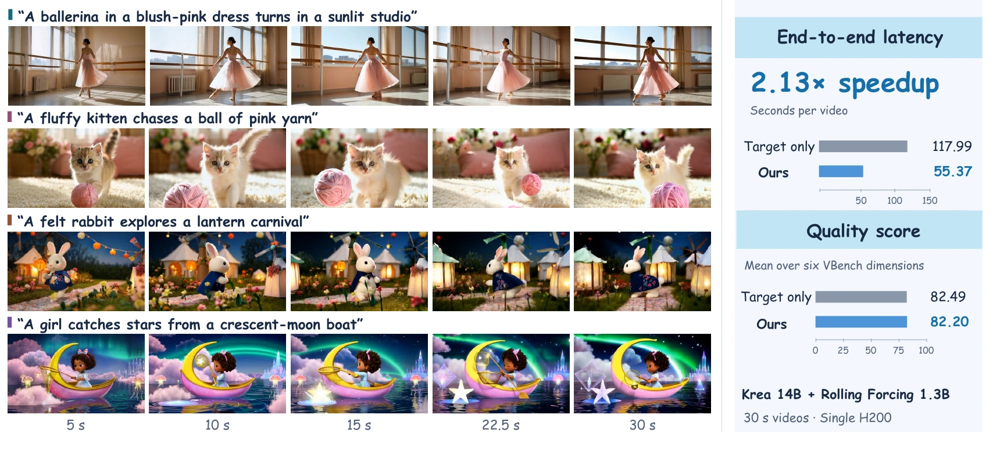

<h1 align="center">Collaborative Forcing</h1>

<p align="center">
  <strong>eRank-Guided Burst Scheduling for Autoregressive Video Generation</strong>
</p>

<p align="center">
  Zirui Lang<sup>1</sup> · Xijun Wang<sup>2</sup> · Wenbiao Zhao<sup>3</sup> · Runzhong Qiao<sup>4</sup><br>
  Saining Zhang<sup>5</sup> <em>(Corresponding author)</em>
</p>

<p align="center">
  <sub><sup>1</sup> Beijing Institute of Technology · <sup>2</sup> University of Science and Technology of China<br>
  <sup>3</sup> Xinjiang University · <sup>4</sup> Tsinghua University · <sup>5</sup> Nanyang Technological University</sub>
</p>

<p align="center">
  <a href="https://langzirui3-sys.github.io/collaborative-forcing-project/"><strong>Project page</strong></a> ·
  <a href="https://langzirui3-sys.github.io/collaborative-forcing-project/paper.pdf"><strong>Paper</strong></a> ·
  <a href="#teaser"><strong>Teaser</strong></a> ·
  <a href="#quick-start"><strong>Quick start</strong></a>
</p>

<p align="center">
  <strong>1.84–2.21×</strong> video-ready speedup over matched Target-only runs on one H200
</p>

<p align="center">
  <a href="https://langzirui3-sys.github.io/collaborative-forcing-project/paper.pdf">
    
  </a>
  <br>
  <sub>Figure 1 from the preprint · Select the figure to open the paper.</sub>
</p>

## Method

<p align="center">
  <a href="https://langzirui3-sys.github.io/collaborative-forcing-project/assets/method.pdf">
    
  </a>
  <br>
  <sub>Method overview · Select the figure to open its vector PDF.</sub>
</p>

A small Draft model generates most of the video. RankPulse uses Draft eRank to schedule
future bursts from the stronger Target. StateBridge preserves valid Draft KV
state, and FuseStep combines the missing-history prefill with the first
resumed Draft denoising step.

The paper compares three Draft backends at 15 and 30 seconds. Video-ready
time includes generation, decoding, and encoding. [Paper, Table 1](https://langzirui3-sys.github.io/collaborative-forcing-project/paper.pdf)

## Teaser

<p align="center">
  <a href="https://langzirui3-sys.github.io/collaborative-forcing-project/#teaser">
    
  </a>
  <br>
  <a href="https://langzirui3-sys.github.io/collaborative-forcing-project/#teaser"><strong>Play the teaser · 1:18</strong></a>
</p>

## Quick start

Start with Rolling Forcing to install the frozen dependencies and run the
method checks. Use Python 3.11 or 3.12. [Install uv](https://docs.astral.sh/uv/)

```sh
git clone https://github.com/langzirui3-sys/collaborative-forcing-release.git
cd collaborative-forcing-release/profiles/rolling-15
uv sync --frozen
uv run --frozen python -m unittest discover -s tests -v
uv run --frozen python -m cfexp.rolling_budget.paper_main --help
```

The tests run on CPU with portable fixtures for causal burst selection,
accepted-history binding, and the stream interfaces. The backend cache
tests use CPU PyTorch when it is installed.

## Release profiles

| Source profile | Draft cache | Target blocks |
| --- | --- | --- |
| [Rolling Forcing · 15 s](profiles/rolling-15/) | Native rolling KV | One root and four later blocks |
| [LongLive · 15 s](profiles/longlive-15/) | Native LongLive KV with FuseStep | One root and four later blocks |
| [Self-Forcing · 30 s](profiles/self-forcing-30/) | Native incremental Draft KV | 37 blocks including the root |

Install each source snapshot in its own environment with its frozen lock.
The LongLive and Self-Forcing entry modules are `cfexp.longlive_matched_main`
and `cfexp.erank_acceptance_pilot`. [Recorded settings](reproduction/profiles.json) ·
[Source revisions](reproduction/source-revisions.json)

To inspect the implementation, start with the causal scheduler, accepted
history representation, and LongLive joint executor. [RankPulse](profiles/rolling-15/src/cfexp/rank_burst.py) ·
[StateBridge](profiles/rolling-15/src/cfexp/correction_state.py) ·
[FuseStep](profiles/longlive-15/src/cfexp/longlive_joint_executor.py)

## GPU reproduction

Use the pinned Linux x86-64 and Python 3.11 dependencies in the selected
profile. The artifact specifications give the upstream revisions,
relative paths, and SHA256 values for the Draft and Krea Target files.
Obtain the sources and checkpoints from their providers. [Causal Forcing](https://github.com/thu-ml/Causal-Forcing) ·
[LongLive](https://github.com/NVlabs/LongLive) · [Self-Forcing](https://github.com/guandeh17/Self-Forcing) ·
[Krea Realtime 14B](https://github.com/krea-ai/realtime-video)

Check the model files from the repository root.

```sh
python3 reproduction/check_assets.py rolling-15 --model-root /path/to/models
```

Supply the local paths listed in the recorded settings and use a separate
`CFEXP_RUN_DIR` for generation outputs. The historical benchmark drivers
require sealed calibration and hardware-specific admission records. A new
GPU reproduction needs validated local inputs and the upstream evaluator
assets. Profile a bounded workload after warm-up, and track the cohort
with W&B using your own credentials or offline mode.

All 350 release test cases passed in local CPU environments, including the
Rolling Forcing and LongLive cache checks with CPU PyTorch. External
end-to-end GPU generation remains unverified.

## Citation

<details>
<summary>BibTeX</summary>

```bibtex
@misc{lang2026collaborativeforcing,
  title  = {Collaborative Forcing: eRank-Guided Burst Scheduling for Autoregressive Video Generation},
  author = {Lang, Zirui and Wang, Xijun and Zhao, Wenbiao and Qiao, Runzhong and Zhang, Saining},
  year   = {2026},
  url    = {https://langzirui3-sys.github.io/collaborative-forcing-project/}
}
```

</details>

## License

The project source and included documentation use Apache-2.0.
[License](LICENSE) · [Third-party attribution](THIRD_PARTY.md)
